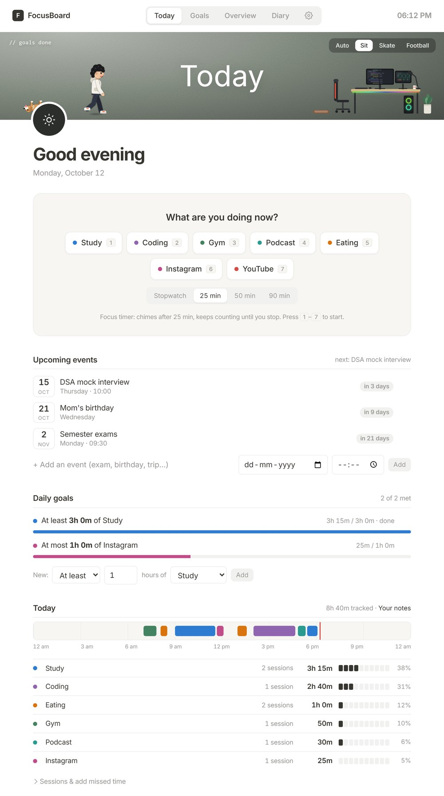
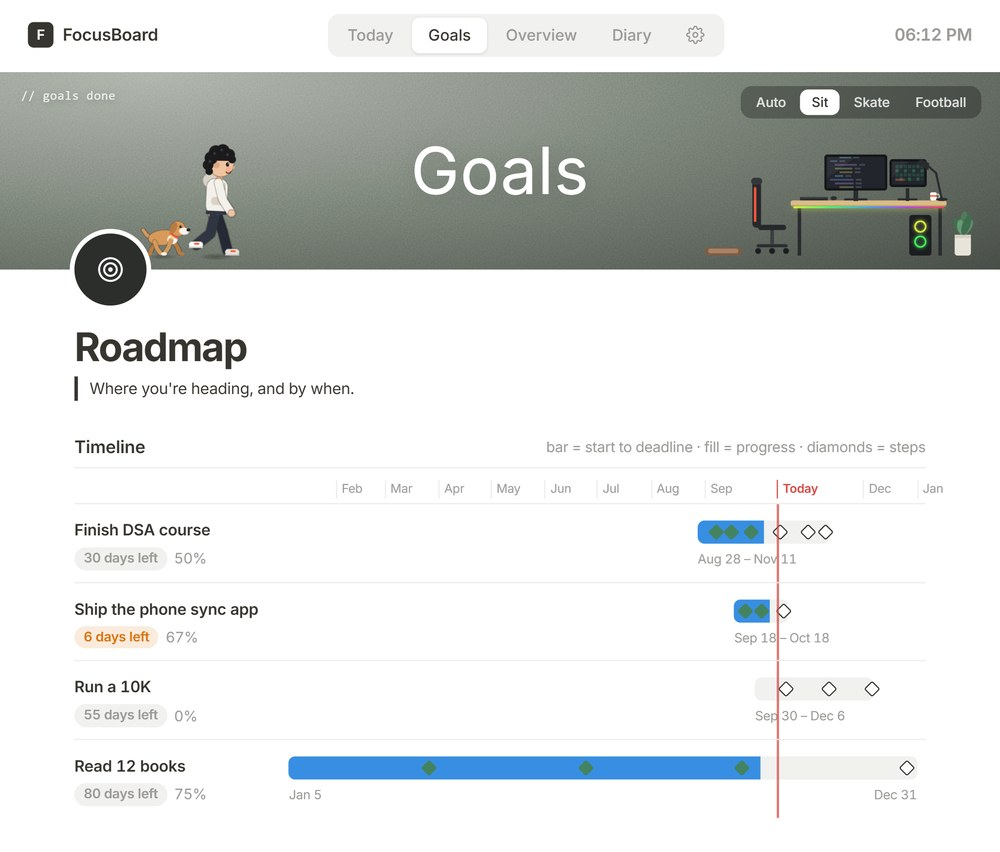
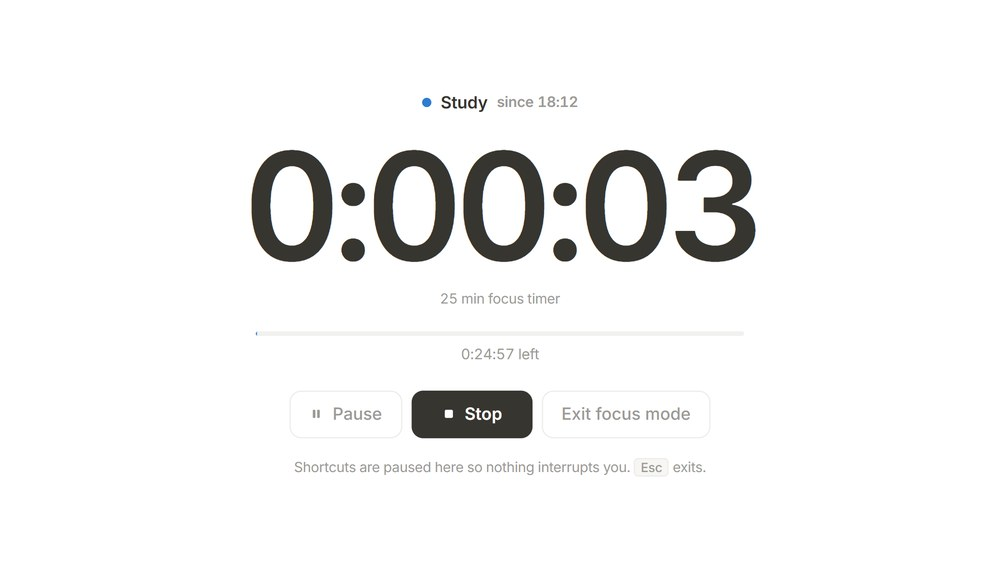
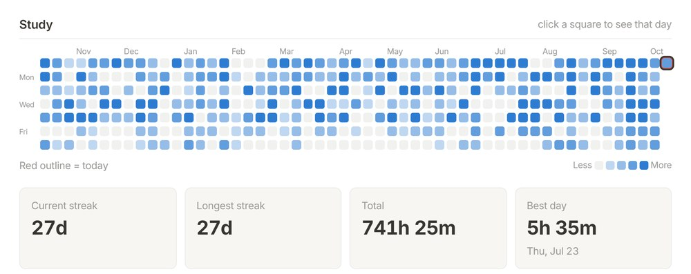
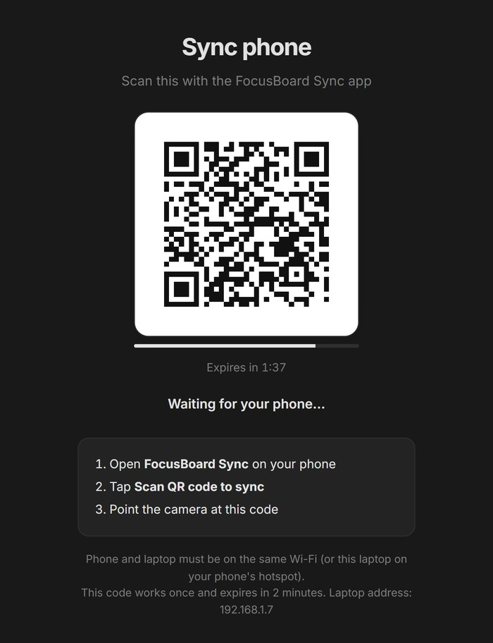

# FocusBoard

**Timers, to-dos, habits, goals, a diary and your phone's screen time, in one HTML file that runs on your laptop.**
No account, no subscription, no server. Your data stays in your browser on your own PC.

▶️ **[Watch the 50-second tour](docs/focusboard-reel.mp4)**



## Why

Most productivity apps are rented: a monthly fee and an account for software your own laptop could run.
FocusBoard is the opposite. It is a single `index.html` file with no build step and no dependencies.
Double-click it and it works, online or offline.

## What it does

| | |
|---|---|
| **Focus timer** | Tap what you are doing and the clock starts. Stopwatch, or a 25 / 50 / 90 minute focus timer that chimes when time is up. One click (or `F`) for a full-screen focus mode with nothing else on it. |
| **Your day on a timeline** | Every session lands on a 24-hour timeline, with a breakdown per activity. Add missed time afterwards. |
| **Daily goals** | "At least 3 h of Study", "At most 1 h of Instagram", with live progress bars. |
| **To-do list** | Priorities (start a task with `!1` for high) and due dates. Start with `1.` to put it first. |
| **Habits** | Tick them off each day; streaks and a 7-day strip per habit. |
| **Goals roadmap** | Goals with steps and deadlines on a timeline: bar = start to deadline, fill = progress, diamonds = steps. |
| **Upcoming events** | Exams, birthdays, trips, with a countdown. |
| **Overview** | A year-long heatmap for any activity or habit (one square a day), current and longest streak, best day, a week view and month cards. |
| **Diary** | One entry a day, search, and an optional password. Click any day to rate it and jot down what you learned. |
| **Phone screen time** | Scan one QR code and your Android phone's screen time shows up next to your day (see below). |
| **A desk buddy** | A small character and his dog on the page cover. He works at his desk while your timer runs. |

Light and dark theme. Keyboard: `1`–`7` start an activity, `P` pause, `Space` stop, `F` focus mode.

| Goals roadmap | Focus mode |
|---|---|
|  |  |



*Screenshots use demo data.*

## Get started (Windows)

1. Download this repository (**Code → Download ZIP**) and unzip it somewhere permanent, for example `Documents\FocusBoard`.
2. Right-click `install.ps1` → **Run with PowerShell**. It puts two shortcuts on your desktop:
   - **FocusBoard**: opens the app in its own window (Chrome or Edge), with its own browser profile in `chrome-profile\`.
   - **Sync phone** (`Ctrl+Alt+P`): starts a phone sync.
3. Open **FocusBoard** and tap an activity.

You can also just open `index.html` in any modern browser. The shortcut is nicer because the app gets its own window
and its data stays separate from your normal browsing.

## Phone sync

The phone side is a small Android app: **[FocusBoard Sync](https://github.com/Abel1712/focusboard-phone)**.

1. Install the app from its Releases page and give it usage access.
2. On the laptop, double-click **Sync phone** (or press `Ctrl+Alt+P`). A QR code appears.
3. In the app, tap **Scan QR code to sync**.



How it stays private:
- The QR code holds a one-time 256-bit key and the laptop's local address. It works once and expires after 2 minutes.
- The phone encrypts its data with that key (AES-256 + HMAC-SHA256) and sends it only to a local network address.
  Phone and laptop must be on the same Wi-Fi (or the laptop on the phone's hotspot).
- The laptop only listens for those 2 minutes, accepts one upload, then forgets the key. Nothing goes to the internet.

## Your data

- Everything is saved in your browser's local storage on this PC (with the shortcut: inside `chrome-profile\`).
  Deleting that folder, or clearing the browser's site data, deletes your data.
- **Back up regularly:** Settings (gear icon) → **Export backup** saves a `.json` file. **Import backup** restores it.
- The only thing FocusBoard loads from the internet is the Inter font from Google Fonts. Offline, it falls back to
  your system font.

### Forgot your diary password?

The diary password is a privacy lock (it keeps the diary closed for anyone glancing at your screen). Entries are not
deleted when you forget it. To remove the password:

1. Open FocusBoard and press `Ctrl+Shift+I` to open the browser's developer tools, then click **Console**.
2. Paste this and press Enter:
   ```js
   delete S.diaryLock; save(); render();
   ```
3. The diary opens. Set a new password in Settings if you want one.

Because the lock is not encryption, anyone with access to your Windows account could do the same. Keep that in mind
for very private notes.

## Files

| File | What it is |
|---|---|
| `index.html` | The whole app |
| `install.ps1` | Creates the desktop shortcuts |
| `sync/receive.ps1` | The laptop side of a phone sync (one-time key, QR code, local listener) |
| `sync/sync.html`, `sync/qr.js` | The QR window |
| `docs/` | Screenshots and the tour video |

## License

[MIT](LICENSE)
